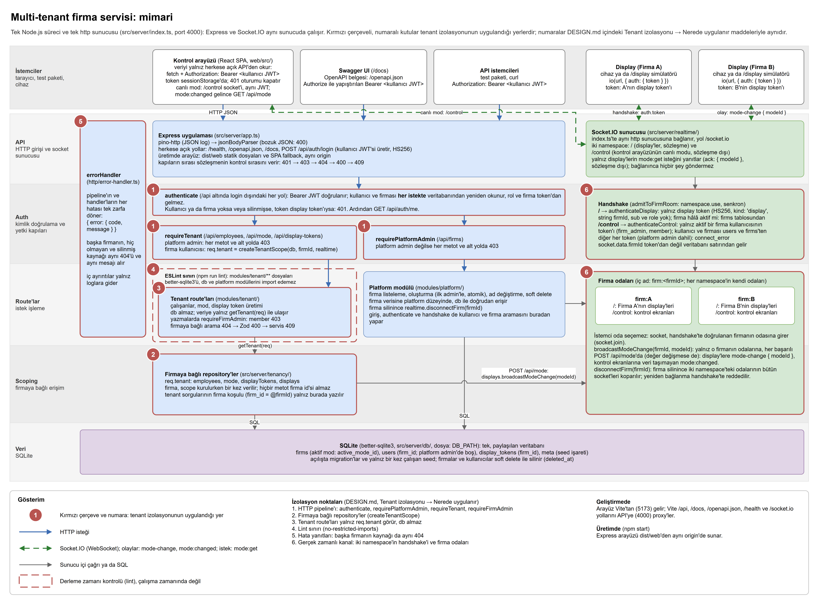
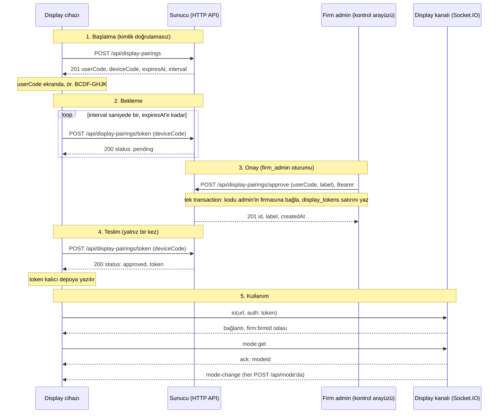

# Tasarım

Bu belge, çok kiracılı (multi-tenant) firma ve çalışan yönetim
servisinin tasarım kararlarını ve gerekçelerini anlatır. Servis Node.js ve TypeScript ile
yazıldı: HTTP için Express 5, veri için better-sqlite3 (SQLite), gerçek zamanlı kanal için
Socket.IO, kontrol arayüzü için React. Dış yüzeyin tek kaynağı
API sözleşmesi; bir çelişkide sözleşme kazanır.

Kurulum ve örnek istekler için [README.md](README.md), belgelerin haritası için
[docs/README.md](docs/README.md), her kararın kısa "neden"i için
[docs/decisions.md](docs/decisions.md) (İngilizce). Katmanlar, izolasyonun uygulandığı noktalar ve
gerçek zamanlı kanal tek resimde: [mimari diyagram](docs/architecture.png)
([draw.io kaynağı](docs/architecture.drawio)).

## Veri modeli

Tek bir SQLite dosyası (`DB_PATH`, varsayılan `./data/app.db`), WAL modu ve
`foreign_keys = ON` ile açılır. Şema, açılışta sırayla uygulanan migration'larla kurulur;
kaçının uygulandığını `PRAGMA user_version` tutar
([src/server/db/migrations.ts](src/server/db/migrations.ts)). ORM yok: SQL, repository'lerde
açıkça yazılır.

| Tablo            | Alanlar                                                                                                         | Notlar                                                                                                                                                                                                  |
| ---------------- | --------------------------------------------------------------------------------------------------------------- | ------------------------------------------------------------------------------------------------------------------------------------------------------------------------------------------------------- |
| `firms`          | `id`, `name`, `active_mode_id`, `created_at`, `updated_at`, `deleted_at`                                        | `active_mode_id` firmanın aktif modudur: sözleşmedeki opak `modeId` gönderildiği gibi saklanır, hiç seçilmediyse `NULL`. Firma adı benzersiz değildir.                                                  |
| `users`          | `id`, `firm_id`, `email`, `email_normalized`, `password_hash`, `role`, `created_at`, `updated_at`, `deleted_at` | `role`: `platform_admin`, `firm_admin` ya da `member`. `email` gönderildiği harf büyüklüğüyle saklanır ve döner; karşılaştırma ve benzersizlik `email_normalized` (kırpılmış, küçük harf) üzerindendir. |
| `display_tokens` | `id`, `firm_id`, `label`, `created_by_user_id`, `created_at`                                                    | `id`, token'daki `jti`'dir. Token'ın kendisi hiçbir yerde saklanmaz. `created_by_user_id` yalnız kayıt içindir, token'ın geçerliliğini etkilemez.                                                       |
| `meta`           | `key`, `value`                                                                                                  | Seed işareti (`seeded_at`).                                                                                                                                                                             |

Kısıtlar:

- **`CHECK`:** `role = 'platform_admin'` ancak ve ancak `firm_id IS NULL`. Firmasız bir kullanıcı
  tam olarak platform admin'dir; bir firma kullanıcısının firması boş olamaz.
- **E-posta benzersizliği:** `email_normalized` üzerinde `WHERE deleted_at IS NULL` koşullu
  benzersiz index. E-posta tüm sistemde ve büyük/küçük harfe duyarsız benzersizdir; silinen bir
  kullanıcının e-postası yeniden kullanılabilir. Uygulama temiz bir `409` için önce kendisi
  kontrol eder; araya giren bir yazma index'e takılırsa o hata da `409`'a çevrilir.
- **`(firm_id, deleted_at)` index'i:** bir firmanın aktif kullanıcılarını okuyan sorgular için.

Kimlikler ve zaman:

- Kimlikler `crypto.randomUUID()` ile üretilen TEXT UUID'lerdir. Tahmin edilemezler, ama izolasyon
  buna dayanmaz: başka firmanın id'sini bilen biri de `404` alır. Bu yalnız ek bir savunma
  katmanıdır.
- Zaman damgaları ISO 8601 biçiminde, UTC, TEXT olarak saklanır.

Soft delete:

- Silme, satırı kaldırmaz, `deleted_at` alanını doldurur; okumalar silinmiş satırları dışarıda
  bırakır. Silinmiş bir kaynak `404`'tür, tekrar gelen bir `DELETE` ya da `PATCH` dahil.
- Firma silme tek bir `BEGIN IMMEDIATE` transaction'ıdır: firmayı ve aktif kullanıcılarını
  birlikte siler, böylece kullanıcıların e-postaları serbest kalır. Commit'ten sonra firmanın
  bağlı display'leri koparılır (bkz. "Tenant izolasyonu", gerçek zamanlı kanal).

Seed ([src/server/db/seed.ts](src/server/db/seed.ts)):

- İlk açılışta, tek bir transaction'da: platform admin ve iki firma, her biri ilk admin'iyle.
  Varsayılan değerlerle "Acme Fuarcılık" (`admin@acme.local`) ve "Globex Etkinlik"
  (`admin@globex.local`). Değerler `SEED_*` ortam değişkenlerinden gelir ve README'de listelidir.
  Tam 2 firma oluşur, üye oluşmaz.
- Seed'in yapıldığı satır sayılarından değil, `meta` tablosundaki işaretten anlaşılır. Seed
  firmaları silinse de ikinci bir seed olmaz.

## Tenant izolasyonu

Farklı firmaların kullanıcıları birbirine düşman kabul edilir: bir kullanıcı başka firmanın
id'lerini tahmin edebilir ya da bir yerden öğrenebilir. Hedef, başka firmanın verisine erişimi
her endpoint'te ve socket kanalında imkânsız kılmak; bunu her sorguya elle `WHERE firm_id = ?`
ekleyerek değil, unutulması zor bir yapıyla yapmak. Başka firmanın kaynağı `404` döner, `403`
değil: yanıt, kaynağın var olup olmadığını da sızdırmaz.

### Nerede uygulanır

Aşağıdaki mimari diyagramda kırmızı çerçeveli kutuların numaraları, bu bölümdeki maddelerin
numaralarıyla aynıdır. Diyagramın düzenlenebilir kaynağı:
[docs/architecture.drawio](docs/architecture.drawio).

**1. HTTP pipeline'ı** ([src/server/app.ts](src/server/app.ts)). Kapılar, sözleşmedeki kontrol
sırasını (`401 → 403 → 404 → 400 → 409`) veren sırayla dizilir:

- `authenticate` (`/api` altında login dışındaki her yol): token'ı doğrular, kullanıcıyı ve
  firmasını her istekte veritabanından yeniden okur; ikisinden biri yoksa ya da silinmişse `401`.
  Rol ve firma token'dan değil, bu okumadan gelir.
- `requirePlatformAdmin` (`/api/firms`): platform admin değilse, her metot ve alt yolda `403`.
- `requireTenant` (`/api/employees`, `/api/mode`, `/api/display-tokens`): firmasız çağıran, yani
  platform admin, her metot ve alt yolda `403` alır; firma kullanıcısı için `req.tenant` kurulur.
- `requireFirmAdmin` (yazma işlemleri): `member` `403` alır.
- Handler: önce firmaya bağlı arama (yoksa ya da başka firmanınsa `404`), sonra Zod ile gövde
  doğrulaması (`400`), sonra servis (e-posta çakışması `409`). Doğrulamanın aramadan sonra
  olması bilinçli: şema önce çalışsaydı, başka firmanın kaynağına bozuk gövdeyle gelen istek
  `404` yerine `400` alırdı.

**2. Firmaya bağlı repository'ler** ([src/server/tenancy/](src/server/tenancy/)).
`createTenantScope(db, firmId)`, bir firmaya bağlı `employees`, `mode` ve `displayTokens`
repository'lerini ve firmanın display kanalını (`displays`) döner:

- Firma, scope kurulurken bir kez verilir: `authenticate`'in o istekte veritabanından okuduğu
  firma. Hiçbir metot firma id'si almaz; handler başka bir firmanın satırını isteyemez, çünkü
  isteyecek bir parametre yoktur.
- Tenant handler'larının okuduğu ve yazdığı her satırın firma koşulu yalnız bu repository'lerde
  yazılır.
- Çağıranın nesnesi SQL parametrelerine yayılırken önce o nesne, sonra repository'nin kendi `id`,
  `firmId` ve `now` değerleri gelir. Yanlışlıkla bir `firmId` taşıyan nesne bile satırı başka
  firmaya yazamaz; bunu çalışan ve display token eklemeleri için birer regresyon testi kanıtlar.

**3. Tenant route'ları yalnız `req.tenant` görür**
([src/server/modules/tenant/](src/server/modules/tenant/)). Route'lar veriye yalnız
`getTenant(req)` ile ulaşır. `app.ts` bu router'ları `db` bağımlılığı vermeden kurar; tenant
kodunun elinde kötüye kullanabileceği bir veritabanı bağlantısı yoktur. `getTenant`,
`requireTenant` arkasında olmayan bir route'ta çağrılırsa istek `500` ile düşer; route anonim
çalışmaz.

**4. Lint sınırı** ([eslint.config.js](eslint.config.js)). `no-restricted-imports` kuralı,
`src/server/modules/tenant/**` dosyalarının `better-sqlite3`'ü, herhangi bir `db` modülünü ya da
`platform` modülünü import etmesini yasaklar (type-only import'lar ve re-export'lar dahil);
ihlal `npm run lint`'i kırar. Kural, gerçek config ile bir testte de denenir
([tests/tenancy/boundary-rule.test.ts](tests/tenancy/boundary-rule.test.ts)). Bu bir korkuluktur,
kum havuzu değil: yalnız statik import'ları görür, dinamik bir `import()` ya da Node'un kendi
`node:sqlite` modülü onu atlatabilir. Asıl güvence, tenant router'larının zaten bir `db`
bağlantısı almamasıdır.

**5. Hata yanıtları.** Başka firmanın, hiç olmayan ve silinmiş bir çalışan aynı `404` kodunu ve
aynı mesajı alır ("Çalışan bulunamadı."); iç ayrıntılar yalnız loglara gider. Platform admin firma
bağlamındaki yollarda `403` alır: firması olmadığı için orada bakabileceği bir kaynak yoktur.

**6. Gerçek zamanlı kanal** ([src/server/realtime/](src/server/realtime/)). Display kanalı (ana
namespace, sözleşme §4):

- Handshake yalnız display token'ı kabul eder: HS256 imzalı, `kind: 'display'`, string bir
  `firmId`, `sub` ya da `role` yok ve firma hâlâ aktif. Aksi halde bağlantı `connect_error` ile
  reddedilir.
- Socket, `firm:<firmId>` odasına girer; firma id'si doğrulanmış token'dan ve veritabanındaki
  firma satırından gelir. İstemci oda seçemez; sunucu istemciden yalnız sözleşme dışı `mode:get`
  isteğini dinler (aşağıda).
- `mode-change` yalnız `broadcastModeChange(firmId, modeId)` ile gönderilir. Tenant handler'ı
  ona da `req.tenant.displays` üzerinden ulaşır; firma burada da scope kurulurken sabitlenir.
- Başarılı her `POST /api/mode`, değer değişmese de olayı gönderir. Bağlanınca hiçbir şey
  gönderilmez.
- Bağlı bir display güncel modu sözleşme dışı `mode:get` isteğiyle sorabilir. Yanıt ack olarak
  yalnız soran socket'e gider ve `GET /api/mode` ile aynı biçimdedir: `{ modeId }`, hiç mod
  seçilmediyse `null`. Firma, handshake'te sabitlenen firmadır; mod `createTenantScope` üzerinden
  okunur ve istekteki hiçbir argüman başka bir firmayı adlandıramaz. İstek hiçbir olay tetiklemez.
- `mode:get` okuyup aynı senkron çağrıda yanıtlar; `POST /api/mode` da kaydedip aynı çağrıda
  yayınlar. Bu yüzden display, yanıtı ve `mode-change` olaylarını modun değiştiği sırayla alır.
- Firma silinince, commit'ten sonra firmanın odasındaki bütün socket'ler koparılır; yeniden
  bağlanmaya çalışan display, aktif firma kontrolünde reddedilir.
- Handshake kontrolü senkrondur: Socket.IO socket'i bu zincirden bir `process.nextTick` sonra
  bağlar, yani aktif firma kontrolü ile odaya katılma arasına bir firma silme isteği giremez.

Kontrol arayüzünün canlı mod kanalı (`/control` namespace'i, sözleşme dışı) aynı kurallarla ayrı
tutulur:

- Handshake yalnız aktif bir firma kullanıcısının (firm_admin ya da member) token'ını kabul eder.
  Kullanıcı ve firması HTTP'deki gibi veritabanından okunur; geçersiz oturum ve yetki mesajları
  HTTP'dekilerle aynıdır. Display token'ı ve izleyeceği bir firma modu olmayan platform admin
  reddedilir.
- Socket, `/control` içindeki `firm:<firmId>` odasına girer; firma id'si token claim'inden değil,
  kullanıcının veritabanı satırından gelir. Odalar namespace'e özeldir: bu oda hiçbir display'i,
  display odası da hiçbir kontrol ekranını içermez.
- `broadcastModeChange` aynı çağrıda bu odaya veri taşımayan bir `mode:changed` gönderir. Mod
  değeri socket'ten gitmez: arayüz sinyali alınca modu `GET /api/mode` ile okur; firma verisi
  yalnız, kullanıcıyı her istekte yeniden denetleyen HTTP yolundan gelir.
- Firma silinince bu odadaki socket'ler de koparılır. Handshake, display'inkiyle aynı yardımcıdan
  (`admitToFirmRoom`) geçer; o da senkrondur.

### Nasıl kanıtlanır

[tests/isolation/](tests/isolation/) klasöründeki testler:

- `cross-tenant.test.ts`: A firmasının token'ı ile B firmasının id'leri, her tenant endpoint'inde
  `404` alır (rol zaten yetmiyorsa `403`) ve hiçbir tabloyu değiştirmez. Başka firmanın, bilinmeyen
  ve silinmiş bir id aynı gövdeyi alır. Sorguya ya da gövdeye sokulan başka firma id'si yok
  sayılır. Token claim'leri firmayı ve rolü seçemez.
- `invalidation.test.ts`: silinen çalışanın token'ı ve girişi sonraki istekte `401` alır; silinen
  firmanın kullanıcıları `401`, display'leri `connect_error` alır ve diğer firma çalışmaya devam
  eder. Rol değişikliği sonraki istekte, iki yönde de uygulanır. Display token'ı, onu üreten
  kullanıcının rolü düşürülüp silinse de çalışır.
- `socket-leak.test.ts`: iki firma, her birinde üç display, aynı anda bağlı. Her olay kendi
  firmasının bütün display'lerine sırasıyla ulaşır, diğer firmanınkilere hiç ulaşmaz. Bir olayın
  gelmediği, ardından gelmesi gereken bir olay gönderilerek kanıtlanır: Socket.IO bir bağlantıda
  sırayı korur, sızan bir olay ondan önce gelirdi. Testler sabit bir bekleme süresine dayanmaz.
  Aynı dosyada iki firmanın admin ve üye kontrol ekranları da bağlıdır: her ekran kendi firmasının
  her olayında tam bir `mode:changed` alır, diğer firmanınkini hiç almaz. Sinyal veri taşımadığı
  için her kontrol ekranı bir display'le aynı bağlantıyı paylaşır ve sayım, o display'e gelen
  bariyer olayında yapılır. İki firmanın altı display'i `mode:get`'i aynı anda da sorar: her biri
  yalnız kendi firmasının modunu alır ve istekler hiçbir display'e olay göndermez.

## Kimlik doğrulama ve yetki

### Token'lar

- HS256 JWT, `JWT_SECRET` ile imzalanır. Doğrulama `algorithms: ['HS256']` ile sabitlenir; token
  kendi algoritmasını (`none` ya da başka bir HMAC) seçemez. HTTP ve socket aynı doğrulama
  fonksiyonunu kullanır ([src/server/auth/tokens.ts](src/server/auth/tokens.ts)).
- Sır yalnız ortamdan gelir, kodda yoktur. `npm start` ilk çalıştırmada `.env` dosyasını oluşturur
  ve rastgele bir `JWT_SECRET` üretir; `JWT_SECRET` yoksa servis açılmaz.
- **Kullanıcı token'ı:** `{ sub, role, firmId? }` ile `iat` ve `exp`. Ömrü `USER_TOKEN_TTL`
  (varsayılan `12h`). Platform admin'de `firmId` gönderilmez: `null` değil, hiç yoktur.
- **Display token'ı:** `{ kind: 'display', firmId }` ile `iat` ve `jti`; `exp` yoktur. `jti`,
  token'ın `display_tokens` satırının id'sidir. Yalnız socket handshake'inde geçer, herhangi bir
  HTTP yolunda `401` alır. Onu üreten kullanıcının silinmesi ya da rolünün değişmesi token'ı
  etkilemez; firması silinince geçersiz olur. Token metni saklanmaz ve loglanmaz.
- Kullanıcı token'ıyla display kanalına bağlanmaya çalışan `connect_error` alır. Kullanıcı
  token'ı socket'te yalnız kontrol arayüzünün `/control` kanalında geçer; orada da display token'ı
  reddedilir.

### Her istekte veritabanı

`authenticate`, token'ın `sub` değeriyle kullanıcıyı her istekte yeniden okur; rol ve firma bu
satırdan gelir, token'daki `role` ve `firmId` claim'leri hiç okunmaz. Böylece rol değişikliği
sonraki istekte uygulanır; silinen bir kullanıcı ya da silinen bir firmanın kullanıcısı, token'ının
süresi dolmadan `401` alır. Bunun için bir blacklist gerekmez. `GET /api/auth/me` (uzantı) aynı
okumadan mevcut kullanıcıyı döner; arayüz rolü buradan öğrenir.

### Şifreler ve giriş

- Şifreler `node:crypto` scrypt ile saklanır: kullanıcı başına 16 baytlık rastgele salt, 64 baytlık
  anahtar, `timingSafeEqual` ile sabit zamanlı karşılaştırma
  ([src/server/auth/password.ts](src/server/auth/password.ts)). Hash asenkron hesaplanır, event
  loop'u bloklamaz; native bir bağımlılık gerekmez.
- Bilinmeyen e-posta, yanlış şifre, silinmiş kullanıcı ve silinmiş firma aynı `401` gövdesini alır
  ("E-posta veya şifre hatalı."). Bilinmeyen bir e-posta da sahte bir hash'e karşı denetlenir; yanıt
  süresi de hangi e-postaların var olduğunu ele vermez.
- Loglarda `Authorization` başlığı ve şifre alanları maskelenir.

### Platform admin modeli

Firma CRUD'u yalnız platform admin tarafından yapılır. Bunun nasıl modellendiği:

- Platform admin ayrı bir tablo ya da ayrı bir giriş yolu değildir: `users` tablosunda
  `role = 'platform_admin'` ve `firm_id = NULL` olan bir satırdır. `CHECK` kısıtı ikisini birbirine
  bağlar: firmasız kullanıcı yalnız platform admin olabilir, platform admin'in firması olamaz.
- Aynı `POST /api/auth/login` ile girer, aynı biçimde bir token alır (`firmId` olmadan) ve aynı
  `authenticate`'ten geçer. Fark yalnız yetkidedir: `/api/firms` altında yalnız platform admin geçer
  (`requirePlatformAdmin`); firma bağlamındaki yollarda (`/api/employees`, `/api/mode`,
  `/api/display-tokens`) her metotta `403` alır.
- Seed tek bir platform admin oluşturur (`SEED_PLATFORM_ADMIN_*`). API'de başka bir platform admin
  oluşturan yol yoktur: çalışan endpoint'leri `role` olarak yalnız `firm_admin` ya da `member`
  kabul eder, `platform_admin` `400` alır.
- Neden böyle: giriş, token ve kimlik doğrulama tek bir yol olarak kalır; sistem çapındaki e-posta
  benzersizliği platform admin'i de kapsar; firmasız bir firma kullanıcısı ya da firmalı bir
  platform admin veritabanı seviyesinde imkânsızdır.

### Kontrol arayüzü

Arayüz, dışarıya açık API'yi HTTP üzerinden, `Authorization: Bearer` ile kullanır; servis
katmanına ya da veritabanına arka bir yolu yoktur. Token `sessionStorage`'da tutulur: sayfa
yenilenince kalır, sekme kapanınca biter. Bir `401` oturumu kapatır ve giriş ekranına döner.

Display simülatörü dışında arayüzün açtığı tek socket, firma çalışma alanındaki `/control`
bağlantısıdır. Bu bağlantı veri taşımaz, yalnız "mod değişti" der; arayüz modu yine
`GET /api/mode` ile okur. Her bağlanışta da okur, böylece bağlantı kopukken kaçan bir değişiklik
de gelir. Bu okuma `401` alırsa oturum her zamanki gibi kapanır, bağlantı da onunla kapanır.

## Trade-off'lar

Her madde: seçim, neden, bedeli.

- **SQLite, tek dosya.** Kurulum gerektirmez; `npm install && npm start` yeter ve testler dosya
  başına bellek içi bir veritabanıyla hızlı çalışır. Bedeli: tek süreç ve tek yazıcı; birden fazla
  instance için bir veritabanı sunucusu gerekir.
- **Ham SQL ve repository'ler, ORM yok.** Tenant koşulu tek bir yerde ve göz önündedir; arada
  sihir yoktur, her sorgu satır satır açıklanabilir. Bedeli: şema değiştiğinde SQL ve tipler elle
  güncellenir.
- **Express 5 ve elle sıralanmış pipeline.** Sözleşmedeki `401 → 403 → 404 → 400 → 409` sırası,
  gövde doğrulamasının kaynak aramasından sonra yapılmasını gerektirir. Şema öncelikli
  framework'ler handler'dan önce doğrular ve `404` yerine `400` verirdi. Bedeli: her handler
  doğrulamayı açıkça çağırır.
- **Her istekte veritabanı okuması.** Silme ve rol değişikliği sonraki istekte geçerli olur,
  blacklist gerekmez (sözleşme §2). Bedeli: her istekte index'li bir sorgu; ölçekte bir önbellek ya
  da daha kısa ömürlü token'lar düşünülmeli.
- **Soft delete.** Silinen kaydın satırı kalır. `display_tokens` satırlarının firmaya ve token'ı
  üreten kullanıcıya bağlanan foreign key'leri kırılmaz, bu yüzden token'ı üreten kullanıcı
  silinse de display token'ı sözleşmedeki gibi çalışmaya devam eder ve kaydı kaybolmaz; firma
  silme, kullanıcılarıyla birlikte tek bir transaction'da iki `UPDATE`'tir. Bedeli: her okuma
  `deleted_at IS NULL` koşulu taşır, e-posta benzersizliği koşullu bir index ister ve veri fiziksel
  olarak silinmez.
- **Süreç içi Socket.IO odaları.** Tek instance için yeterli, ek servis gerektirmez. Bedeli: ikinci
  bir süreç, başka süreçteki display'lere yayın yapamaz; yatay ölçekte Redis adapter gibi paylaşılan
  bir katman gerekir.
- **Koşulsuz yayın, bağlanınca yayın yok.** Sözleşme her başarılı `POST /api/mode`'da olay istiyor;
  bağlanınca kendiliğinden gönderilen bir olay, sözleşme testlerindeki "tam bir olay" ya da "hiç olay
  yok" beklentilerini bozabilirdi. Bedeli: yeniden bağlanan bir display güncel modu kendiliğinden
  almaz, onu sözleşme dışı `mode:get` ile sorması gerekir (N4). Simülatör her bağlanışta sorar;
  yalnız sözleşmedeki olayı bilen bir display ise bir sonraki `POST /api/mode`'u bekler.
- **Kontrol kanalında veri yok, yalnız sinyal.** `/control` her değişiklikte yalnız `mode:changed`
  gönderir; mod değeri, kullanıcıyı her istekte yeniden denetleyen HTTP'den okunur. Bu yüzden
  açık bir bağlantı, çalışan silinince, rolü değişince ya da token'ının süresi dolunca koparılmaz:
  arayüzün sinyalden sonra yaptığı okuma `401` alır, oturumu ve bağlantıyı kapatır; yeniden
  bağlanma handshake'te reddedilir. Bedeli: her değişiklikte açık ekran başına bir `GET /api/mode`
  isteği ve silinmiş bir kullanıcının elle yazılmış bir istemcisinin, bağlantıyı kapatana kadar
  modun değiştiğini (değerini değil) öğrenebilmesi.
- **Display token'ında `exp` ve revoke yok.** Sözleşme böyle tanımlıyor ve kiosk'un yeniden giriş
  yapma yolu yok; `jti` ileride revoke için saklanır. Bedeli: sızan bir display token'ı firma
  silinene kadar geçerlidir; yalnız o firmanın mod değişikliklerini dinleyebilir, HTTP'de `401`
  alır.
- **`sessionStorage` ve Bearer, HttpOnly cookie değil.** Sözleşme tarayıcıdan
  `Authorization: Bearer` istiyor; cookie olmadığı için CSRF yüzeyi de yok. Bedeli: bir XSS token'ı
  okuyabilir. Arayüz kullanıcı metnini yalnız React ile, kaçışlı olarak render eder.
- **Lint sınırı bir korkuluk.** Ayrı bir paket ya da çalışma zamanı sandbox'ı yerine lint kuralı ve
  tenant router'larına `db` verilmemesi. Bedeli: dinamik bir `import()` kuralı atlatabilir; bunu
  kod incelemesi yakalamalı.
- **Son firma admin'i korunmuyor.** Sözleşme bu durumu tanımlamıyor; engellemek sözleşme testleriyle
  çelişebilirdi. Bedeli: bir firma yönetilemez kalabilir (N2).
- **Türkçe `error.message`, sözleşmedeki `code`.** Sözleşme örneği Türkçe, arayüz mesajı olduğu gibi
  gösterir, testler `code`'a bakar. Bedeli: tek dil; i18n kapsam dışı.
- **Node'un varsayılan scrypt maliyeti** (N=16384, r=8, p=1). Giriş ve testler hızlı kalır. Bedeli:
  OWASP daha yüksek bir maliyet öneriyor; yükseltmek hash biçimine bir sürüm ya da yeniden seed
  gerektirir.

## Sözleşme notları

Sözleşme, bulunan çelişki ve belirsizliklerin DESIGN.md'de "sözleşme notu" olarak yazılmasını
istiyor. Sözleşmedeki yollar, istek ve yanıt şekilleri değiştirilmedi; sözleşmenin sustuğu yerde
seçilen davranış ve gerekçesi aşağıda. Swagger açıklamalarında ve kodda geçen not numaraları
bunlarla aynıdır.

**N1: Node ≥ 18 ve bugünkü ekosistem.** Sözleşme §1 `Node.js ≥ 18` diyor. Node 18'in desteği Nisan
2025'te, Node 20'ninki Nisan 2026'da bitti. better-sqlite3 13.x Node 22 ve üstünü ister, 12.x Node
20-26'yı destekler, 11.x ise en yeni Node sürümleri için hazır binary içermez. Node 18'den bugünkü
sürümlere kadar hazır binary'yle çalışan bir sürüm yok; temiz bir makinede C++ derleme araçları
gerekirdi. Ne yaptık: `engines` alanında `>=20.19`; Node 22 ve 24 ile doğrulandı; daha eski bir
Node'da `npm start` anlaşılır bir mesajla durur.

**N2: Bir firma yönetilemez kalabilir.** Son `firm_admin` kendini silebilir ya da `member`'a
düşürebilir. `platform_admin` `/api/employees`'ta `403` alır (§3) ve firma yolları yalnız adı
değiştirir; firmayı kurtaracak bir yol kalmaz. Ne yaptık: engellemedik, çünkü sözleşme böyle bir
kural ya da durum kodu tanımlamıyor ve engellemek sözleşme testleriyle çelişebilirdi. Öneri: platform
admin'in bir firmaya admin atayabileceği bir endpoint ya da tanımlı bir durum koduyla son admin
kuralı.

**N3: Silinen firmanın bağlı display'leri.** §2 silinen firmanın display token'larını geçersiz sayar
ve yeni bağlantıya `connect_error` tanımlar, ama o anda bağlı olan socket'lere ne olacağını
söylemez. Ne yaptık: firma silme commit edildikten sonra firmanın odasındaki bütün socket'leri
koparıyoruz; yeniden bağlanma handshake'te reddedilir.

**N4: Display güncel modu öğrenemez.** Display token HTTP'de `401` alır (§2) ve bağlanınca bir
senkron tanımlı değil (§6 bunu serbest bırakıyor). §4'e göre yeniden bağlanan display'in senkronu
koşulsuz yayına dayanır; yani display, bir sonraki `POST /api/mode`'a kadar güncel modu bilemez. Ne
yaptık: bağlanınca kendiliğinden olay göndermiyoruz; sözleşme testlerindeki olay sayısı beklentilerini
bozabilirdi. Bunun yerine sözleşme dışı, ack ile yanıtlanan bir `mode:get` ekledik: bağlı bir
display güncel modu sorabilir, yanıt yalnız ona gider ve `GET /api/mode` ile aynı biçimdedir. Öneri:
bu isteğin ya da bir eşdeğerinin sözleşmeye girmesi; o zaman her display yeniden bağlanınca
modunu öğrenebilir.

**N5: Çalışanı id ile okuma yok.** A firmasının token'ıyla B firmasının çalışanının
"okunamaz" olduğunun test edilmesi gerekir ve §3'teki `403` kuralı `/api/employees/:id` yolunu
"tüm metotlarıyla" anıyor; ama tabloda `GET /api/employees/:id` yok. Ne yaptık: uzantı olarak
ekledik. Firmadaki herkes kullanabilir; başka firmanın ya da silinmiş bir çalışan `404` alır.

**N6: Mevcut kullanıcıyı veren bir endpoint yok.** Rol oturum ortasında değişebiliyor (§2), ama
güncel rolü öğrenmenin yolu yok; login yanıtındaki rol eskiyebilir. Ne yaptık: `GET /api/auth/me`
uzantısı. Kullanıcıyı token'dan değil veritabanından okur ve login'deki `user` ile aynı şekli
döner; arayüz rol yönlendirmesini buna dayandırır.

**N7: Tanımsız davranışlar.** Sözleşme şunları tanımlamıyor; seçimlerimiz aşağıdaki tabloda:

- e-posta biçim doğrulaması ve dönen e-postanın harf büyüklüğü
- şifre politikası
- kullanıcı token'ının ömrü
- şifre değiştirme (endpoint yok)
- `member`'ın arayüzde ne göreceği
- desteklenmeyen HTTP metotları (`405` kod listesinde yok)

**N8: Display token'ında bir kimlik yok.** Sözleşmedeki display claim'leri token'ı ayırt edecek bir
kimlik içermiyor; §6'da kapsam dışı bırakılan revoke ileride eklenirse buna ihtiyaç olacak. Ne
yaptık: kayıtlı (registered) `jti` claim'ini ekledik; değeri, token'ın `display_tokens` satırının
id'sidir. Sözleşmedeki claim'ler değişmedi; revoke uygulanmadı.

### Sözleşmenin sustuğu yerlerde seçimlerimiz

| Konu                       | Seçim                                                                                                                                                                                                                                                                                                                    | Gerekçe                                                                                                                |
| -------------------------- | ------------------------------------------------------------------------------------------------------------------------------------------------------------------------------------------------------------------------------------------------------------------------------------------------------------------------ | ---------------------------------------------------------------------------------------------------------------------- |
| Parse edilemeyen JSON      | `400 VALIDATION_ERROR`. JSON olarak geçerli ama nesne olmayan gövdeler (`"x"`, `null`, `42`) normal kontrol sırasından geçer.                                                                                                                                                                                            | §3 `400` ya da `401`'e izin verir.                                                                                     |
| Bilinmeyen yol ya da metot | `404 NOT_FOUND` zarfı, `405` yok. `/api` altında önce kimlik doğrulama çalışır: token yoksa `401`.                                                                                                                                                                                                                       | `405` kod listesinde yok; §3 "tüm metotlarıyla".                                                                       |
| E-posta                    | Kırpılır; `local@domain` biçiminde ve boşluksuz olmalı, yoksa `400`. Büyük/küçük harfe duyarsız karşılaştırılır, gönderildiği harf büyüklüğüyle saklanır ve döner. Kendi e-postasını farklı harflerle göndermek çakışma değildir. Girişte biçim kontrolü yok: biçimsiz bir e-posta kimseyle eşleşmez, normal `401` alır. | §3 duyarsız karşılaştırma; gönderilen biçimi döndürmek eşitlik kontrolleri için en güvenlisi.                          |
| Şifre                      | Boş olmayan bir string; politika yok; kırpılmadan hash'lenir.                                                                                                                                                                                                                                                            | Sözleşme yalnız boş olmamayı tanımlar.                                                                                 |
| Zorunlu string'ler         | String ve kırpıldıktan sonra boş olmayan bir değer, yoksa `400`. Bilinmeyen alanlar yok sayılır; güncellenebilir alan içermeyen bir `PATCH` `400` alır.                                                                                                                                                                  | §3 notları.                                                                                                            |
| Firma adı                  | Kırpılır, benzersiz değil.                                                                                                                                                                                                                                                                                               | `409` yalnız e-posta için tanımlı.                                                                                     |
| `modeId`                   | Boş olmayan herhangi bir string; kırpılmadan saklanır ve döner.                                                                                                                                                                                                                                                          | §3: opak string.                                                                                                       |
| Display `label`            | Opsiyonel; gönderilirse string olmalı, yoksa `400`. Token'a değil veritabanına yazılır.                                                                                                                                                                                                                                  | Sözleşme label'ın amacını tanımlamıyor; token'ı büyütmeden kaydıyla birlikte saklanır. Henüz onu döndüren bir yol yok. |
| Kullanıcı token'ının ömrü  | `USER_TOKEN_TTL`, varsayılan 12 saat; refresh token yok.                                                                                                                                                                                                                                                                 | §6 oturum politikalarını serbest bırakır.                                                                              |
| Platform admin'de `firmId` | Login yanıtında ve token'da hiç yok, `null` değil.                                                                                                                                                                                                                                                                       | §2 "platform_admin'de firmId yoktur"; §3 ikisini de kabul eder.                                                        |
| Son `firm_admin`           | Koruma yok.                                                                                                                                                                                                                                                                                                              | N2.                                                                                                                    |
| Bağlanınca mod             | Gönderilmez; display `mode:get` ile sorabilir.                                                                                                                                                                                                                                                                           | N4; §6 serbest bırakır.                                                                                                |
| Yanıt alanları             | Yalnız sözleşmedeki alanlar.                                                                                                                                                                                                                                                                                             | Ek alan bir şey katmıyor.                                                                                              |
| Giriş hatası               | Bilinmeyen e-posta, yanlış şifre, silinmiş kullanıcı ve silinmiş firma için aynı `401` mesajı.                                                                                                                                                                                                                           | Hesap tahminini önler.                                                                                                 |
| `error.message`            | Türkçe, kısa, kullanıcıya yönelik; `code` sözleşmedeki gibi. Eksik ve başka firmanın kaynağı aynı mesajı alır.                                                                                                                                                                                                           | Sözleşme örneği Türkçe; testler `code`'a bakar; i18n kapsam dışı.                                                      |
| Beklenmeyen hata           | `500 INTERNAL_ERROR`, aynı zarf ve genel bir Türkçe mesaj; ayrıntı yalnız logda.                                                                                                                                                                                                                                         | Sözleşmede sunucu hatası kodu yok; zarfın şekli her yerde aynı kalır.                                                  |
| Şifre değiştirme           | Endpoint yok.                                                                                                                                                                                                                                                                                                            | Sözleşmede yok (N7).                                                                                |
| `member` arayüzü           | Çalışanları ve modu salt okunur görür.                                                                                                                                                                                                                                                                                   | N7.                                                                                                                    |

### Sözleşmeye eklenenler

Üç endpoint Swagger'da "(uzantı)" olarak işaretli; diğerleri Swagger açıklamalarında yazılı:

- `GET /api/employees/:id` (N5)
- `GET /api/auth/me` (N6)
- `GET /health`: kimlik doğrulaması gerektirmeyen canlılık kontrolü
- `500 INTERNAL_ERROR`: beklenmeyen sunucu hataları için
- Display token'ında `jti` claim'i (N8)
- Kontrol arayüzünün `/control` socket namespace'i ve veri taşımayan `mode:changed` event'i
- Display kanalında ack ile yanıtlanan `mode:get` isteği (N4)

## Database-per-tenant

Tasarım sorusu:

> Sistem büyürse **database-per-tenant** modeline geçiş ne zaman ve neden mantıklı olur? Bu
> şema bu geçişi kolaylaştırıyor mu, zorlaştırıyor mu?

Bugünkü ölçekte paylaşımlı veritabanı doğru varsayılan: tek şema, tek migration, yeni bir firma
yalnız bir satır, izolasyon da yukarıda anlatılan yapıyla sağlanıyor.

### Ne zaman ve neden

Geçiş şu durumlarda mantıklı olur:

- **Gürültülü komşu ya da sıcak noktalar:** bir firmanın yükü diğer firmaların gecikmesini
  bozuyorsa, o firmayı kendi veritabanına almak yükü ayırır.
- **Sözleşmesel ya da yasal fiziksel izolasyon:** KVKK kapsamındaki bir gereksinim ya da verisinin
  başka firmalarla aynı veritabanında durmasını kabul etmeyen kurumsal bir müşteri.
- **Firma bazında yedekleme ve geri yükleme:** paylaşımlı bir veritabanında tek bir firmanın
  verisini bir ana geri döndürmek zordur; ayrı bir veritabanında bu sıradan bir geri yüklemedir.
- **Veri yerleşimi:** bir firmanın verisinin belirli bir ülkede ya da bölgede tutulması gerekiyorsa.

Bedelleri: her şema değişikliği N veritabanına uygulanır; bağlantı yönetimi (havuzlar, açık
dosya ve bağlantı sayısı) büyür; firmalar arası raporlama zorlaşır; izleme, yedek ve sürüm takibi
gibi operasyon yükü artar. Bu yüzden geçiş hepsi bir arada olmak zorunda değil: firmaların çoğu
paylaşımlı veritabanında kalırken yalnız bu şartları taşıyan firmalar kendi veritabanlarına
alınabilir.

### Şemamız geçişi kolaylaştırıyor mu?

**Büyük ölçüde kolaylaştırıyor; tek ciddi zorluk, e-postayla girişin firmadan bağımsız olması.**

Kolaylaştıranlar:

- **Her tenant satırında `firm_id` var.** `users` ve `display_tokens` satırları firmalarına
  bağlı, aktif mod firmanın kendi satırında. Bir firmanın bütün verisi tek bir koşulla eksiksiz
  ayrılabilir.
- **Firmalar arası foreign key yok.** Bir satır yalnız kendi firmasına ve o firmanın
  kullanıcılarına bağlanır (display token'ı üreten kullanıcı da aynı firmadandır); firmalar
  birbirinden koparıldığında kırılan bir ilişki kalmaz.
- **UUID kimlikler.** Veritabanları bölünse ya da birleştirilse kimlikler çakışmaz; otomatik artan
  sayılar olsaydı yeniden numaralama gerekirdi.
- **`createTenantScope` tek dikiş noktası.** Tenant kodu veriye yalnız buradan ulaşıyor. Geçişte bu
  fonksiyon firmanın kendi veritabanı bağlantısını seçip repository'lere verir; route'lar ve
  handler'lar değişmez.
- **Migration'lar bağlantı başına çalışıyor.** `PRAGMA user_version` her veritabanı dosyasının kendi
  sürümünü tutar; aynı mekanizma her firma dosyasına uygulanabilir.

Zorlaştıranlar:

- **E-posta tüm sistemde benzersiz ve giriş yalnız e-posta ve şifre alıyor** (sözleşme §3). Giriş
  anında kullanıcının hangi firmadan olduğu bilinmiyor. Firma veritabanları ayrıldığında "bu
  e-posta kimin?" sorusunu cevaplayacak bir kontrol düzlemi (control plane) dizini gerekir:
  e-postadan firmaya bir eşleme, benzersizlik de orada zorlanır. Bugün koşullu benzersiz index bunu
  tek veritabanında kendiliğinden yapıyor; ayrıldığında e-posta ekleme, değiştirme ve silme hem
  dizine hem firma veritabanına yazılmalı ve ikisi tutarlı tutulmalıdır.
- **Firmalar, platform admin ve `meta` kontrol düzleminde kalır.** Firma oluşturmak yeni bir
  veritabanı açmak, firma silmek de hem dizini hem firma veritabanını değiştirmek demektir.
- **`authenticate` her istekte kullanıcıyı `sub` ile okuyor.** Hangi veritabanına bakacağını bilmek
  için token'daki `firmId`'ye ya da dizine başvurması gerekir. `firmId` bugün yalnız bir ipucu;
  orada yalnız yönlendirme için kullanılır, doğrulama yine firma veritabanındaki satırla yapılır.

Gerçek zamanlı kanal etkilenmez: odalar zaten doğrulanmış token'daki `firmId` ile ayrılıyor;
handshake'teki aktif firma kontrolü kontrol düzleminden yapılır.

## Cihaz eşleştirme (tasarım)

Ek bir konu: display'ler login yapamayan kiosk cihazlarıdır; kısa ömürlü bir
eşleştirme kodu (pairing code) ile cihazı firmaya bağlayıp kalıcı bir display token'ı üreten bir
akış. Bu bölüm önerilen tasarımdır; `main`'de bu akışın kodu yoktur. Bugün bir display token'ı
tek bir yolla alınır: firm_admin onu `POST /api/display-tokens` ile üretir ve cihaza elle girer.

Akışın biçimi: cihaz eşleştirmeyi başlatır ve bir kod gösterir, firm_admin bu kodu kontrol
arayüzünde onaylar, cihaz token'ını sonra alır. Bu, OAuth 2.0 Device Authorization Grant'in
([RFC 8628](https://www.rfc-editor.org/rfc/rfc8628)) kalıbıdır. Neden: kiosk login yapamaz ve
çoğu zaman klavyesi yoktur. Bu akışta cihaz yalnız bir kod gösterir, ona hiçbir şey yazılmaz;
kodu, oturum açmış ve klavyesi olan admin girer.

### Akış

1. **Başlatma.** Saklı bir token'ı olmayan cihaz `POST /api/display-pairings`'i gövdesiz çağırır.
   Uç login gibi herkese açıktır, `authenticate`'ten önce kaydedilir. Yanıt
   `201 { userCode, deviceCode, expiresAt, interval }`:
   - `userCode`: `BCDFGHJKLMNPQRSTVWXZ` alfabesinden 8 karakter (RFC 8628 §6.1: sesli harf ve
     birbirine benzeyen karakter yok), ekranda `XXXX-XXXX` biçiminde; yaklaşık 2,56 × 10^10
     olasılık. Admin'in girdiği değer büyük harfe çevrilir, tire ve boşluklar atılır. Süresi
     dolmamış bekleyen kodlar arasında benzersizdir; çakışırsa yeniden üretilir.
   - `deviceCode`: `crypto.randomBytes` ile 32 rastgele byte, base64url. Cihaz onu saklar;
     herkese açık tarafın tek sırrıdır.
   - `expiresAt`: başlatmadan 10 dakika sonra. `interval`: iki yoklama arasındaki 5 saniye.
2. **Bekleme.** Cihaz `userCode`'u ekranda gösterir ve `interval` saniyede bir
   `POST /api/display-pairings/token`'ı `{ deviceCode }` gövdesiyle çağırır; onay gelene kadar
   yanıt `200 { status: 'pending' }`. Kodlar path'te değil gövdede gider: pino-http istek logu
   URL'yi yazar, gövdeyi yazmaz.
3. **Onay.** Firm admin, kontrol arayüzünde kodu ve isteğe bağlı bir `label` girer:
   `POST /api/display-pairings/approve`, gövde `{ userCode, label? }`; `authenticate`,
   `requireTenant` ve `requireFirmAdmin` arkasında. Tek bir transaction'da bekleyen ve süresi
   dolmamış satır koşullu bir `UPDATE` ile çağıranın firmasına bağlanır (bir kodu yalnız bir onay
   alabilir), `display_tokens` satırı mevcut `req.tenant.displayTokens.create` ile yazılır
   (üreten kullanıcı onaylayan admin, `label` gövdeden) ve eşleştirme bu satıra bağlanır. Yanıt
   `201 { id, label, createdAt }`; `id`, cihazın alacağı token'ın `jti`'sidir.
   - Hatalar: `401` (token yok, geçersiz ya da display token'ı), `403` (`member`; platform admin
     `requireTenant`'ta), `400` (`userCode` boş olmayan bir metin değil ya da `label` metin
     değil), `404` (bilinmeyen, süresi dolmuş ya da zaten onaylanmış kod; üçü de aynı mesajla).
   - Sıra `401 → 403 → 400 → 404`: aranacak anahtar gövdede olduğu için önce gövde doğrulanır.
     Path'te firmaya ait bir kaynak yoktur, bekleyen bir eşleştirme de henüz hiçbir firmanın
     değildir; bu `404` firmaya ait hiçbir şeyi sızdırmaz.
   - Firma gövdeden gelmez: `createTenantScope`'a eklenecek, firmaya bağlı bir
     `displayPairings` repository'si, diğer tenancy repository'leri gibi scope'un firmasını yazar.
4. **Teslim.** Onaydan sonraki ilk yoklama, tek bir transaction'da satırın onaylanmış, süresi
   dolmamış, henüz teslim edilmemiş ve firmasının hâlâ aktif olduğunu görür, satırı teslim edildi
   diye işaretler ve token'ı mevcut `signDisplayToken` ile, bağlı `display_tokens` satırının id'si
   ve firmasıyla imzalar: `200 { status: 'approved', token }`, yalnız bir kez. Bilinmeyen, süresi
   dolmuş, zaten teslim edilmiş ya da onaydan sonra firması silinmiş bir `deviceCode` `404` alır
   ve token imzalanmaz.
   - Token, `POST /api/display-tokens`'ın verdiğiyle aynı claim'leri taşır (`kind: 'display'`,
     `firmId`, `jti`; sözleşme §2 gereği `exp` yok). Bu yüzden handshake, firma odası,
     `mode-change`, `mode:get`, firma silinince geçersizleşme ve bağlı display'lerin koparılması
     (N3) olduğu gibi geçerlidir. Token metni saklanmaz ve loglanmaz.
5. **Kullanım.** Cihaz token'ı kalıcı olarak saklar (tarayıcı tabanlı bir display'de
   `localStorage`), `io(url, { auth: { token } })` ile bağlanır, güncel modu `mode:get` ile sorar
   (N4) ve `mode-change`'i dinler. Sonraki açılışlarda eşleştirme yapılmaz. Token'ı yalnız bir
   handshake reddi (ağ hatası değil) siler ve cihazı eşleştirme ekranına döndürür.

### Önerilen tablo

`display_pairings` (yalnız tasarım, migration yok):

- `id`: UUID.
- `user_code`: normalize edilmiş kod, düz metin. Kısa ömürlüdür ve yalnız oturum açmış bir
  firm_admin'den kabul edilir; tek başına bir token'a çevrilemez.
- `device_code_hash`: `deviceCode`'un SHA-256'sı, benzersiz. 256 bitlik rastgele bir değer için
  hızlı bir hash yeter; scrypt, tahmin edilebilir şifreler içindir.
- `firm_id` ve `display_token_id`: onaya kadar `NULL`.
- `created_at`, `expires_at`, `approved_at`, `delivered_at`.

Durum ayrı bir kolonda tutulmaz, zaman damgalarından çıkar. Süresi dolan ve teslim edilen satırlar
bir temizlikle silinir (örneğin yeni bir eşleştirme başlarken); kalıcı kayıt `display_tokens`
satırıdır.

### Güvenlik ve izolasyon

- Herkese açık tarafın tek sırrı 256 bitlik `deviceCode`'dur. Kısa `userCode` yalnız oturum açmış
  bir firm_admin'den kabul edilir.
- Tahmin edilen bir `userCode`, en fazla bekleyen bir ekranı tahmin edenin kendi firmasına
  bağlayabilir. Ekran o zaman tahmin edenin modlarını gösterir, öbür firmanın hiçbir verisi sızmaz
  (bekleyen bir eşleştirme veri taşımaz) ve gerçek admin'in onayı `404` alır, yani durum fark
  edilir. Kod uzayı, 10 dakikalık ömür ve tek kullanım bunu çok düşük bir olasılığa indirir. Gerçek
  bir uygulama ayrıca iki herkese açık uca IP başına, başarısız onaylara kullanıcı başına rate
  limiting ekler; rate limiting bu projenin kapsamı dışındadır.
- İzolasyonun uygulandığı yerler, "Nerede uygulanır"daki numaralarla: onay 1. maddedeki
  kapılardan geçer; firma `req.tenant`'tan, bir tenancy repository'si üzerinden gelir (2. ve 3.
  madde); tenant route'u yine `db` almaz, lint sınırı (4. madde) değişmez; teslim edilen token
  sıradan bir display token'ıdır, 6. madde olduğu gibi geçerlidir.
- Yarışlar: aynı koda iki onay gelirse biri kazanır, öbürü `404` alır; onaydan sonraki iki
  yoklamadan yalnız biri token'ı alır.

### Sınırlar

- Başka bir firmaya taşınan cihaz sıfırlanıp yeniden eşleştirilir, ama eski token'ı iptal (revoke)
  gelene kadar geçerli kalır (N8, `jti`). Onaydaki `label` bu yüzden önemlidir: ileride iptal
  edilecek token'ı adıyla bulmayı sağlar.
- Teslim yanıtı yolda kaybolursa cihaz baştan başlar; teslim edilmemiş `display_tokens` satırı bir
  kayıt olarak kalır.

### Neden başka bir akış değil

- **Admin'in ürettiği ve cihaza yazılan kod:** kiosk'ta giriş gerektirir; kısa kod da herkese açık
  bir uçta taşıyıcı (bearer) bir kimlik bilgisine dönüşür ve tahmin edilmesi, başka bir firmanın
  mod akışını dinleyen canlı bir token verir.
- **Token'ı taşıyan bir QR kod:** kamera gerektirir ve uzun ömürlü token bir fotoğrafta görünür.
- **Yoklama yerine socket ile gönderim:** tek seferlik bir kurulum için üçüncü bir handshake türü;
  5 saniyelik yoklama bu işe yeter.

### Sözleşmeyle ilişkisi

Yalnız ekleme. Uygulanırsa üç yol Swagger'da "(uzantı)" olarak işaretlenir. Sözleşmedeki display
claim'leri ve display kanalı değişmez; `POST /api/display-tokens` elle token üretimi ve kabul
testleri için kalır.

### Uygulanırsa

- `display_pairings` için bir migration.
- Onay için `createTenantScope`'ta firmaya bağlı bir `displayPairings` repository'si; başlatma ve
  teslim için login gibi herkese açık bir modül.
- Firma çalışma alanında yalnız firm_admin'e görünen bir "Ekran eşleştir" formu (kod ve `label`);
  display simülatöründe bir eşleştirme modu.
- OpenAPI'de üç uzantı yolu.
- Testler: platform admin `403`, member `403`, zaten onaylanmış kod `404`, süre dolumu, tek onay
  ve tek teslim, eşzamanlı onay, onay ile teslim arasında silinen firma ve teslim edilen token'ın
  handshake'ten geçip onaylayan firmanın odasına girmesi.

## Önceliklendirme

Öncelikler: gerekçeli önceliklendirme, sözleşmeye
birebir uyum (sözleşme testleri), yapısal tenant izolasyonu (ana odak), sızıntısız bir gerçek zamanlı
kanal, temiz bir makinede tek komutla çalışma, anlamlı bir commit geçmişi ve sözleşme hatalarının
bildirilmesi. İşler bu önceliklere göre üç gruba ayrıldı
([blueprint/build-plan.md](blueprint/build-plan.md)):

- **P0, sözleşme çekirdeği (1-9):** sözleşme testlerinin doğrulayacağı her şey. Sıra bağımlılıklara
  göre: önce şema ve seed (şema baştan kilitlendi, sonraki her şey ona dayanıyor), sonra hata zarfı
  ve giriş, her isteğin ilk kapısı olan kimlik doğrulama ve firma yönetimi. Tenant scope katmanı,
  onu kullanacak çalışan ve mod endpoint'lerinden önce yazıldı; böylece hiçbir tenant sorgusu bu
  katman olmadan yazılmadı. Gerçek zamanlı kanal mod ve display token'ı hazır olunca geldi. P0'ı,
  sözleşme testlerinin aynası olan izolasyon ve sözleşme test matrisi kapattı.
- **P1, zorunlu teslimler (10-16):** Swagger, kontrol arayüzü, display simülatörü, tek komutla
  çalışma ve README, bu belge ve mimari diyagram. Çekirdek testlerle doğrulanmadan başlanmadı.
- **P2, bonus (17-19):** kontrol arayüzünde canlı mod, display'in güncel modu isteyebilmesi ve
  cihaz eşleştirme akışı; yalnız P0 ve P1 yeşilken.

Gerçekleşen (`git log --first-parent main`):

- P0'ın dokuz maddesi 25.09 ile 27.09 13:38 arasında `main`'e girdi; ilk kontrol noktası
  tetiklenmedi.
- P1'in 10-14 maddeleri 27.09 akşamı ile 28.09 akşamı arasında bitti; README ve tek komutla
  çalışma planın bir gün önünde tamamlandı.
- Bu belge yazılırken (29.09 gecesi) P1'den yalnız bu belge ve mimari diyagram kalmıştı; P2
  maddelerine başlanmamıştı.
- Mimari diyagram 29.09'da, bu belgeden sonra eklendi; P1 böylece tamamlandı.
- P2'nin 17. maddesi (kontrol arayüzünde canlı mod) 29.09'da yapıldı.
- P2'nin 18. maddesi (display'in güncel modu `mode:get` ile isteyebilmesi) de 29.09'da yapıldı.

Her özellik küçük, incelenmiş adımlarla ve adım başına bir commit'le yapıldı. İncelemelerde bulunan
hatalar, bir sonraki özelliğe geçmeden ayrı `fix/` dallarında kapatıldı.

## Daha fazla zamanım olsaydı

- **Yatay ölçekleme:** Socket.IO için Redis adapter ve paylaşılan bir veritabanı sunucusu; birden
  fazla instance ancak böyle aynı firmanın display'lerine yayın yapabilir.
- **Display token iptali:** `jti` üzerinden bir iptal listesi, firmanın token'larını `label`'larıyla
  listeleme ve arayüzden iptal etme (N8).
- **N2'nin çözümü:** platform admin'in bir firmaya admin atayabilmesi ya da tanımlı bir durum
  koduyla son admin kuralı.
- **Şifre değiştirme ve şifre politikası** (N7).
- **Refresh token ve oturum politikaları:** daha kısa ömürlü erişim token'ları, oturum kapatınca
  token'ın geçersizleşmesi.
- **Girişte rate limiting** ve bir **audit log**; ikisi de bu projenin kapsamı dışında.
- **Daha yüksek bir scrypt maliyeti:** hash biçimine bir sürüm ekleyerek, mevcut hash'leri bozmadan.
- **Unix benzeri bir sistemde temiz klon doğrulaması:** README, Windows'ta Node 22 ve 24 ile temiz
  klondan doğrulandı; WSL ya da Linux'ta denenmedi.
- **Tarayıcıda uçtan uca testler:** arayüzün DOM'suz modülleri test ediliyor, ama bir tarayıcı test
  altyapısı yok; arayüz elle doğrulandı.
- **Kalan P2 bonusu:** cihaz eşleştirme akışı.

## AI kullanımı

- Bu projeyi baştan sona Claude Code ile birlikte yazdım: planlar, spec'ler, kod, testler ve
  belgeler, bu belge dahil.
- İş, AI Blueprint iş akışıyla yürüdü: önce proje planı ve build planı, sonra her özellik için bir
  spec. Spec onaylanınca özellik küçük adımlarla uygulandı; her adımı inceleyip onayladıktan sonra
  commit ettim ve her özellik `main`'e bir merge commit'iyle girdi.
- Kural: AI'ın yazdığı hiçbir şey, satır satır açıklayamadığım sürece commit edilmedi.
- Özelliklerin çoğu kapanmadan önce ayrıca denetlendi (audit); hassas olanlarda, yazan oturumdan
  bağımsız ve temiz bağlamlı bir inceleyici oturumu kodu bir kez daha gözden geçirdi. Bulgular ve
  sonuçları özellik arşivlerinde, düzeltmeler ayrı `fix/` dallarındadır.
- Commit'lerde AI imzası (`Co-Authored-By` gibi) yok; AI kullanımı bunun yerine burada ve
  kayıtlarda açıkça belgelendi.
- Kayıtlar: planlar, spec'ler ve inceleme bulguları [blueprint/](blueprint/) altında; AI kodlama
  araçlarının çalışma talimatları [AGENTS.md](AGENTS.md) ve [CLAUDE.md](CLAUDE.md) dosyalarında.
